# 🧠 Edge-AI Learning Journey · ESP32-S3

> An embedded engineer's learning log: from ML basics to running real AI apps on **ESP32-S3**.
> **Hardware:** ESP32-S3 (dual-core LX7 + PSRAM, supports TFLite Micro / ESP-DL)
> **Duration:** ~6 months (3–5 hrs per week)

---

## 🎯 Learning Goals

- [ ] Understand ML from scratch: Linear Regression → Logistic Regression → Neural Network basics
- [ ] Master model compression & memory optimization: quantization, Tensor Arena, PSRAM
- [ ] Port & run TFLite Micro on ESP32-S3; ship 1–2 real apps
- [ ] Build reusable notes as personal technical assets

---

## 📊 Progress Board

**Progress: 0%**  `░░░░░░░░░░░░░░░░░░░░ 0%`

```mermaid
gantt
    title Edge-AI Progress (axis = Month N)
    dateFormat X
    axisFormat %s
    section S1 · ML Basics
    ML Basics (Months 1-2)        :s1, 1, 3
    section S2 · Compression
    Compression (Months 3-4)      :s2, 3, 5
    section S3 · ESP32-S3 Porting
    Porting (Months 4-5)          :s3, 4, 6
    section S4 · Ship & Wrap
    Ship & Wrap (Months 5-6)      :s4, 5, 7
```



---

## 🗺️ Roadmap

```text
ML Basics              Compression              ESP32-S3 in action
01 Linear Reg ─┐
02 Logistic Reg ├─► 04 Quantization ─┐
03 Neural Net   │                    ├─► 07 ESP32-S3 Setup ─► 08 TFLite Micro ─► 09 Projects
               └─► 06 CNN ──────────┘   (05 Memory Opt. throughout)
```

| # | Topic | Goal | Status |
|---|-------|------|--------|
| 01 | Linear Regression | Gradient descent, loss function | ⏳ |
| 02 | Logistic Regression | Binary classification, Sigmoid, cross-entropy | ⏳ |
| 03 | Neural Network | Feed-forward, backpropagation | ⏳ |
| 04 | Quantization | PTQ / QAT, INT8 | ⏳ |
| 05 | Memory Optimization | Tensor Arena, PSRAM | ⏳ |
| 06 | CNN | Convolution, image-classification primer | ⏳ |
| 07 | ESP32-S3 Setup | ESP-IDF, PSRAM, acceleration | ⏳ |
| 08 | TFLite Micro Porting | esp-nn acceleration, inference | ⏳ |
| 09 | Projects | 1–2 real apps + benchmark | ⏳ |

---

## 📅 Milestone Plan & Outline

### Stage 1 · ML Basics — Months 1–2
- [ ] **01 Linear Regression** — gradient descent, MSE loss
- [ ] **02 Logistic Regression** — binary classification, Sigmoid, cross-entropy
- [ ] **03 Neural Network** — feed-forward, backprop, activation
- [ ] 🛠️ Hands-on: minimal neural network in NumPy

### Stage 2 · Compression & Optimization — Months 3–4
- [ ] **04 Quantization** — FP32→INT8, PTQ / QAT, scale / zero-point
- [ ] **05 Memory Optimization** — Tensor Arena, Flash / RAM / PSRAM, activation reuse
- [ ] **06 CNN** — convolution, pooling, depthwise-separable
- [ ] 🛠️ Hands-on: MNIST train + INT8 quant compare (accuracy / size)
- [ ] 💡 Add-on: input alignment — embedded input must match training (normalize / resize / MFCC), or accuracy collapses

### Stage 3 · ESP32-S3 Porting — Months 4–5
- [ ] **07 ESP32-S3 Setup** — ESP-IDF, PlatformIO, PSRAM enable, esp-nn / ESP-DL
- [ ] **08 TFLite Micro Porting** — convert pipeline, esp-nn kernels, inference flow
- [ ] 🛠️ Hands-on: port official `hello_world` (sine) example, validate full chain
- [ ] 💡 Add-on: model-conversion pipeline — Keras → TFLite → TFLite Micro (`.tflite`→C array)
- [ ] 💡 Add-on: ESP32-S3-specific optimization — PSRAM allocation, activation reuse, esp-nn / ESP-DL, dual-core split

### Stage 4 · Ship & Wrap — Months 5–6
- [ ] **09 Example 1**: ESP32-S3 Hello World (sine prediction, required)
- [ ] **09 Example 2**: real app (pick one or both)
      - 📷 Image Classification — ESP32-S3 + OV2640 (capture → preprocess → infer)
      - 🎤 Wake-word — ESP32-S3 + INMP441 (MFCC → classify)
- [ ] 📏 Benchmark: inference latency, Flash / RAM / PSRAM footprint, power
- [ ] ⚡ Optimize: quant strategy, kernel swap, memory tuning
- [ ] 💡 Add-on: benchmarking methodology — latency (cache/DMA), memory (arena sizing), power (deep-sleep)
- [ ] 💡 Optional: pruning & distillation — only when the model won't fit on the board
- [ ] 📝 Compile notes + shareable content

---

## 🐛 Pitfall Log

| Issue | Context | Cause | Fix | When |
|-------|---------|-------|-----|------|
| TBD | - | - | - | - |

---

## 📚 References


---

## 🛡️ Disclaimer

Personal learning log only. All teardowns/benchmarks use public information or self-funded hardware. No company secrets, client projects, or unreleased products.
